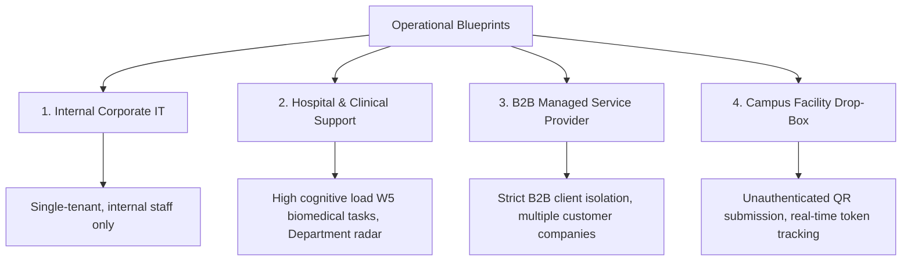

# ⚡ Tantou (担当) — Complete User & Administrator Guide

Welcome to **Tantou (担当)** — the Open-Core Human Capacity Operating System.

Unlike traditional ticket queues that encourage infinite backlogs and worker burnout, Tantou is engineered around **real, finite cognitive capacity**. It gives teams a visual, real-time workload canvas where tasks ("Post-its") reflect mental weight ($W1–W5$), column load thresholds prevent overload, and team members can collaborate live via Web and Telegram.

---

## 📑 Table of Contents

1. [Philosophy & Core Concepts](#1-philosophy--core-concepts)
2. [DevOps & Docker Deployment](#2-devops--docker-deployment)
   - [Architecture Stack](#architecture-stack)
   - [60-Second Quickstart](#60-second-quickstart)
   - [Mode A: Private Intranet IP Mode](#mode-a-private-intranet-ip-mode-air-gapped)
   - [Mode B: Production Domain Mode with Caddy & Auto-SSL](#mode-b-production-domain-mode-with-caddy--auto-ssl)
   - [Background Services & Telegram Polling](#background-services--telegram-polling)
3. [Administrator & Coordinator Operations](#3-administrator--coordinator-operations)
   - [The 4 Operational Blueprints](#the-4-operational-blueprints)
   - [Organization Branding & Workspace Settings](#organization-branding--workspace-settings)
   - [Strict B2B Client Isolation](#strict-b2b-client-isolation)
   - [SLA Analytics, Timezones & CSV Reports](#sla-analytics-timezones--csv-reports)
   - [Features & Unrestricted Capacity](#features--unrestricted-capacity)
4. [Worker & Collaborator Workflows](#4-worker--collaborator-workflows)
   - [Cognitive Load Weights ($W1–W5$)](#cognitive-load-weights-w1w5)
   - [Two-Stage Active Workflow: Assigned vs Doing](#two-stage-active-workflow-assigned-vs-doing)
   - [Availability Status & Capacity Bar](#availability-status--capacity-bar)
   - [Co-Op Assistance & Bounty Point Splits](#co-op-assistance--bounty-point-splits)
   - [3-Tier Visibility Firewalls](#3-tier-visibility-firewalls)
   - [Telegram Bot Integration & Inline Actions](#telegram-bot-integration--inline-actions)
5. [Client & Guest Drop-Box Experience](#5-client--guest-drop-box-experience)
   - [Public Guest Drop-Box (`/submit/{slug}`)](#public-guest-drop-box-submitslug)
   - [Live Public Request Tracker (`/track/{token}`)](#live-public-request-tracker-tracktoken)
   - [Authenticated Client Portal](#authenticated-client-portal)

---

## 1. Philosophy & Core Concepts

Traditional issue trackers treat teams like infinite conveyor belts. When tickets pile up in lists, managers have no visibility into cognitive load, and workers suffer silent burnout.

**Tantou inverts control:**
- **Cognitive Load over Count:** A server migration is not equivalent to a password reset. Tasks consume between $1$ and $5$ units of human capacity.
- **Visual Overload Signals:** When a worker's capacity bar reaches $100\%$, the column changes from indigo to warning amber and alert rose.
- **Live Collaborative Canvas:** All board interactions (cards dragging, status changes, assignments) sync instantaneously to all connected users via Laravel Reverb WebSockets.

---

## 2. DevOps & Docker Deployment

### Architecture Stack

| Component | Technology | Purpose |
| :--- | :--- | :--- |
| **App Engine** | PHP 8.4-FPM Alpine | Core application logic, Livewire 3 reactivity, API |
| **Web Server** | Caddy 2 | Reverse proxy, automatic Let's Encrypt SSL, static files, WebSocket proxy |
| **Database** | MariaDB 11 | High-performance transactional storage with tenant isolation |
| **Cache & Queue** | Redis 7 Alpine | Session driver, background queue worker, and Reverb state |
| **WebSockets** | Laravel Reverb | Real-time live canvas board synchronization |
| **Telegram Poller** | Background Worker | Long-polling worker for 2-way Telegram bot actions on intranets |

### 60-Second Quickstart

```bash
# 1. Clone the repository
git clone https://github.com/ktsourdinis/tantou-oss.git
cd tantou-oss

# 2. Configure environment
cp .env.example .env

# 3. Start the Docker stack
docker compose -f docker-compose.example.yml up -d

# 4. Generate application key & run database migrations
docker compose -f docker-compose.example.yml exec -u 1000:1000 app php artisan key:generate
docker compose -f docker-compose.example.yml exec -u 1000:1000 app php artisan migrate --seed

# 5. Access Tantou
# Open your browser at http://localhost
```

### Mode A: Private Intranet IP Mode (Air-Gapped)

For internal hospital intranets, laboratory subnets, or air-gapped corporate servers (e.g. `http://192.168.1.100:8085`):

1. In `.env`:
   ```dotenv
   APP_URL=http://192.168.1.100:8085
   REVERB_HOST=192.168.1.100
   REVERB_PORT=8080
   REVERB_SCHEME=http
   VITE_REVERB_HOST=192.168.1.100
   VITE_REVERB_PORT=8080
   VITE_REVERB_SCHEME=http
   TANTOU_TELEGRAM_MODE=polling
   ```
2. No inbound ports or public domains are required. Tantou will automatically route all requests seamlessly without DNS requirements.
3. The included `telegram_poll` background container will use outbound long-polling to Telegram servers, enabling full two-way interactive buttons without needing an inbound webhook!

### Mode B: Production Domain Mode with Caddy & Auto-SSL

For production domain hosting (e.g. `https://ops.yourcompany.com`):

1. Point your DNS `A` or `CNAME` record to your server's public IP.
2. In `.env`:
   ```dotenv
   APP_URL=https://ops.yourcompany.com
   REVERB_HOST=ops.yourcompany.com
   REVERB_PORT=443
   REVERB_SCHEME=https
   VITE_REVERB_HOST=ops.yourcompany.com
   VITE_REVERB_PORT=443
   VITE_REVERB_SCHEME=https
   ```
3. In `Caddyfile.example`, replace `{$DOMAIN:localhost}` with `ops.yourcompany.com`.
4. Caddy will automatically provision and renew Let's Encrypt / ZeroSSL TLS certificates and proxy WebSocket connections over `wss://ops.yourcompany.com/app/*`.

---

## 3. Administrator & Coordinator Operations

### The 4 Operational Blueprints

Tantou accommodates 4 distinct operational paradigms:



#### 1. Internal Corporate IT / Shared Services
- **Target:** In-house IT, DevOps, HR, and Operations teams.
- **Setup:** Staff are categorized into departments (e.g., Infrastructure, Applications, Workplace).
- **Workflow:** Workers claim requests from the Backlog queue or coordinators assign requests based on live Department Capacity Radar.

#### 2. Hospital & Clinical Engineering Support
- **Target:** Biomedical technicians, hospital maintenance, and emergency IT.
- **Setup:** High cognitive weight ($W4–W5$) assigned to life-critical equipment tasks.
- **Workflow:** Mobile technicians receive notifications and claim emergency repairs via Telegram Bot while on facility rounds.

#### 3. B2B Managed Service Providers (MSPs)
- **Target:** Outsourced IT, cloud service providers, customer engineering firms.
- **Setup:** Enable **Strict B2B Client Isolation** in Workspace Settings.
- **Workflow:** Each customer company has designated `client` accounts with their `Facility Name` assigned. Clients can only see their own requests and cannot see tickets or workers of competing companies.

#### 4. Campus Facility & Guest Drop-Box
- **Target:** Educational institutions, co-working spaces, property management.
- **Setup:** Enable **Public Guest Drop-Box** in Workspace Settings.
- **Workflow:** Place QR codes pointing to `/submit/{slug}` around the building. Visitors submit maintenance issues without account creation and track progress live via `/track/{token}`.

---

### Organization Branding & Workspace Settings

In **Workspace Settings** (Admin Only):
- **Organization Name:** Displayed on headers, emails, and drop-box pages.
- **Workspace Identifier (Slug):** Organization slug identifying your workspace.
- **Custom Domain & Reverse Proxy:**
  - Configure your organizational domain (e.g., `ops.yourcompany.com`).
  - Point your DNS record to your Tantou server or Caddy reverse proxy.
  - Tantou automatically serves your workspace securely under your domain.

### Strict B2B Client Isolation

When enabled:
- Clients with a `Facility Name` (e.g., "Acme Healthcare") are firewalled.
- They only see requests created by their own organization.
- Other clients' tasks on the live board are completely hidden, ensuring 100% GDPR, HIPAA, and client confidentiality compliance.

### SLA Analytics, Timezones & CSV Reports

Under the **Team & Leaderboard** tab (`/team`):
- **Timezone-Aware:** Each tenant can set their official operational timezone (e.g., `Europe/Athens`, `America/New_York`).
- **Metrics Dashboard:**
  - **SLA Breach Rate:** Percentage of requests exceeding priority target durations.
  - **Mean Time to Resolution (MTTR):** Average execution time from `Started` to `Done`.
  - **Department Bottleneck Heatmap:** Pinpoints overloaded queues.
- **CSV Export:** One-click download of all completed and archived requests with execution timestamps, assignee handoffs, and bounty points.

### Features & Unrestricted Capacity

In the **Self-Hosted Community Edition**, all features and capacities are completely unlocked with zero restrictions:
- **Unlimited Team Workers & Departments:** Add as many collaborators and coordinators as needed without artificial user caps.
- **Strict B2B Client & Facility Isolation:** Protect internal operations from client-facing requests with automated security firewalls.
- **Telegram Bot Automation:** Real-time push notifications, 1-click claim/start/complete callbacks, and polling mode for air-gapped networks.
- **Full SLA Analytics & Reports:** Bottleneck heatmaps, MTTR resolution statistics, and one-click CSV report exports.
- **Zero-Login Facility Drop-Box & Live Tracking:** QR code ticket submission with real-time public progress tracking at `/track/{token}`.

---

## 4. Worker & Collaborator Workflows

### Cognitive Load Weights ($W1–W5$)

Every Post-it is assigned a mental weight:

| Weight | Cognitive Load | Typical Examples | Visual Height |
| :---: | :--- | :--- | :---: |
| **W1** | **Trivial** (15–30 mins) | Password reset, DNS record tweak, software license grant | Compact |
| **W2** | **Light** (1–2 hours) | Email inbox provisioning, monitor setup, routine script run | Standard |
| **W3** | **Moderate** (Half Day) | Workstation rebuild, network switch port config, SSL cert install | Medium |
| **W4** | **Heavy** (Full Day) | Database migration, firewall rule refactor, incident analysis | Large |
| **W5** | **Critical** (Multi-Day) | Core infrastructure outage, cluster deployment, security audit | Expanded |

### Two-Stage Active Workflow: Assigned vs Doing

To accurately measure execution metrics, Tantou separates planned work from active clock time:

```
[Unassigned Backlog] 
        │
        ▼ (Drag to Worker Column)
   [ASSIGNED] ─── (Consumes Capacity, started_at = null)
        │
        ▼ (Click "▶ Start")
    [DOING] ────── (Active Timer Running, started_at = now())
        │
        ▼ (Click "✓ Complete")
     [DONE] ────── (Bounty Points Awarded, completed_at = now())
```

### Availability Status & Capacity Bar

Workers can toggle their availability status:
- 🟢 **Working:** Available to receive assignments and client requests.
- 🌙 **Away:** Dimmed on the board, excluded from client drop-down lists, and their capacity is excluded from Department Radar denominators.

### Co-Op Assistance & Bounty Point Splits

When a task requires joint effort:
- The lead assignee can invite a **Helper** from their department.
- Select a **Helper Split** (e.g., $30\%$).
- Upon completion, bounty points are automatically divided between lead and helper, updating the **Team Recognition Leaderboard**.

### 3-Tier Visibility Firewalls

Tantou protects team focus with three column visibility modes:
1. **Public:** Visible to everyone, including client viewers.
2. **Internal:** Visible only to internal staff (`worker`, `coordinator`, `admin`). Requests originating from clients can never enter internal columns.
3. **Private:** Strictly visible to the column owner for personal staging and sensitive drafting.

---

### Telegram Bot Integration & Smart Routing

Tantou provides intelligent, isolation-enforced Telegram notifications and two-way interactive inline task management.

#### 1. Personal 1-on-1 Worker Pairing (`/start usr_...`) — For Every Collaborator
- **How to Pair:** Open the `✈️ Telegram` button in the top navigation bar, click **"Open Telegram & Pair (1-Click)"** or send `/start usr_{token}` to the bot in a private 1-on-1 chat.
- **Strict Isolation:** When a task is assigned directly to you, **ONLY you** receive the direct push alert with `[ ▶️ Start Working ]` and `[ ✅ Complete ]` buttons. Other workers and department channels are never spammed.
- **Zero-Group Backlog Routing:** If your department does not have a shared Telegram Group, unassigned backlog tasks submitted to your department are automatically sent to the private chat of all available (`is_available = true`) workers in your department with `[ 🙋‍♂️ Claim ]` buttons! Your team does not need to create Telegram groups to receive real-time backlog alerts.

#### 2. Optional Department Group Linking (`/link dept_...`) — For Shared Team Rooms
- **How to Link:** Only if your team wants a shared Telegram group room for a department:
  1. Create a Telegram Group (e.g., *"Facilities Team"*) and invite the Tantou Bot.
  2. A workspace administrator clicks **"Get Link Command"** for that department in the `✈️ Telegram` modal or Workspace Settings.
  3. Send `/link dept_{token}` inside the Telegram Group.
- **Routing Rules:** Unassigned backlog tickets for that department are posted to the group room with `[ 🙋‍♂️ Claim ]` buttons. Once claimed or assigned, updates go exclusively to the assigned worker—the group chat is NEVER spammed with individual worker execution updates.
- **1-Click Unlink:** Admins can click **`Unlink`** next to any department in the `✈️ Telegram` modal or Workspace Settings to immediately disconnect the group.

#### Bot Commands
- `/queue` — View unassigned backlog requests in your department with instant **Claim** buttons.
- `/mine` — View your currently active tasks ($W1–W5$).
- `/status` — View your current capacity consumption and availability state.

#### Interactive Inline Buttons
Whenever a request is assigned or mentioned, an alert is sent with live inline buttons:
- `[ 🙋‍♂️ Claim ]` — Takes ownership of an unassigned request.
- `[ ▶️ Start Working ]` — Transitions card to `doing` and starts the execution clock.
- `[ ✅ Complete ]` — Finishes the request, records MTTR, and awards bounty points.

All actions taken in Telegram instantly update the Livewire canvas in real-time via WebSockets!

---

## 5. Client & Guest Drop-Box Experience

### Public Guest Drop-Box (`/submit/{slug}`)

Organizations can share their public drop-box link (or print a QR code):
- Visitors enter: Title, Description, Department, Priority, and optional File Attachments.
- No password or account registration is required.
- Submitting immediately issues a unique **Live Tracking Token** (e.g., `#TNT-7K9X2M`).

### Live Public Request Tracker (`/track/{token}`)

Requesters can bookmark or open their tracking link on mobile:
- **Live Status Badge:** Shows `Pending Review`, `In Progress`, or `Resolved`.
- **Assignee Avatar & Name:** Shows which collaborator is handling the request.
- **Real-Time Updates:** Status updates refresh dynamically without manual page reloads.

### Authenticated Client Portal

Registered B2B clients log in at `/login`:
- Can view their own submitted tickets across all statuses.
- Can reassign their own unstarted tickets between available public collaborators.
- Cannot see internal staff notes, private columns, or other client organizations' tickets.

---

## 6. Summary & Support

Tantou provides total transparency of team workload while strictly safeguarding focus and privacy.

- **Source Code & Issue Tracker:** [GitHub Repository](https://github.com/ktsourdinis/tantou-oss)
- **Live Interactive Demo:** [https://tantou.app/demo](https://tantou.app/demo)
- **License:** GNU AGPL v3.0 (AGPL-3.0-or-later) / Commercial Enterprise
